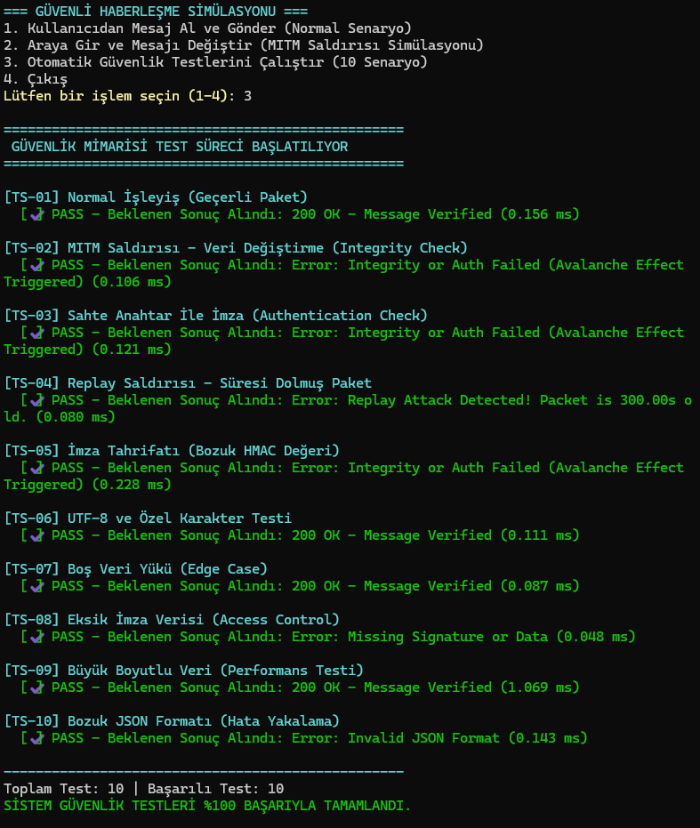
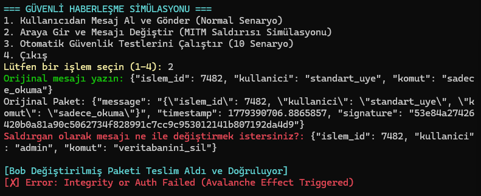
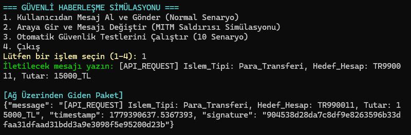

# 🔐 Hash- and HMAC-Based Message Integrity and Authentication System

## 📌 Overview

This project demonstrates a secure message verification mechanism designed to protect communication between a sender and a receiver over potentially untrusted networks.

Using **HMAC-SHA256**, the system verifies message integrity and authenticates messages using a shared secret key. It also implements timestamp-based validation to reject expired messages and demonstrate protection against replay attacks.

The project includes an interactive terminal interface, a simulated Man-in-the-Middle (MITM) attack, and an automated security testing suite.

## 🎯 Problem Definition

Communication over untrusted networks can be vulnerable to message tampering, forged data, and replay attacks. An attacker may intercept a message, modify its contents, or attempt to reuse a previously captured packet.

This project explores how cryptographic message authentication and timestamp validation can help detect these threats and reject invalid messages.

## ✨ Features

- **HMAC-SHA256 Authentication:** Generates message authentication codes using a shared secret key.
- **Message Integrity Verification:** Detects modifications to messages after their signatures have been generated.
- **MITM Attack Simulation:** Demonstrates how modifying an intercepted message causes verification to fail.
- **Replay Attack Detection:** Rejects packets that exceed a configurable time window.
- **Timestamp Validation:** Rejects messages with future timestamps.
- **Constant-Time Signature Comparison:** Uses Python's `hmac.compare_digest()` for signature verification.
- **Automated Security Tests:** Executes 10 test scenarios covering valid messages, tampering, invalid signatures, replay attempts, malformed packets, and edge cases.
- **Interactive Terminal Interface:** Allows users to exchange messages and simulate message manipulation.
- **Performance Measurement:** Measures verification execution time for individual test scenarios.

## 🛠️ Technologies

- **Python 3**
- `hmac` — Message authentication
- `hashlib` — SHA-256 hashing algorithm
- `json` — Message packet serialization
- `time` — Timestamp validation and execution-time measurement

## 🔄 How It Works

1. The sender creates a message and generates a timestamp.
2. The message and timestamp are combined and signed using HMAC-SHA256 with a shared secret key.
3. The sender packages the message, timestamp, and signature into a JSON object.
4. The receiver checks that all required fields are present.
5. The receiver validates the timestamp against the allowed time window.
6. The receiver generates an expected HMAC and compares it with the received signature.
7. The message is accepted only if the timestamp and signature checks pass.

## 🧪 Automated Security Tests

The project includes 10 test scenarios:

| Test | Scenario | Expected Result |
|---|---|---|
| TS-01 | Valid message delivery | Accepted |
| TS-02 | Message tampering / MITM simulation | Rejected |
| TS-03 | Forged message signed with an incorrect key | Rejected |
| TS-04 | Expired packet / replay attempt | Rejected |
| TS-05 | Modified HMAC signature | Rejected |
| TS-06 | UTF-8 and special characters | Accepted |
| TS-07 | Empty message payload | Accepted |
| TS-08 | Missing signature field | Rejected |
| TS-09 | Large message payload (50,000 characters) | Accepted |
| TS-10 | Malformed JSON packet | Rejected |

The test suite also records verification execution times and reports the overall test pass rate.

## 📸 Screenshots

### 1. Automated Security Tests

Shows the automated test suite evaluating valid messages, tampered packets, invalid signatures, replay attempts, and other test scenarios.



### 2. MITM Attack Simulation

Demonstrates a simulated attacker modifying an intercepted message without updating its HMAC signature, causing the receiver to reject the packet.



### 3. Normal Working Scenario

Shows the standard communication workflow in which a message is signed, transmitted as a JSON packet, and successfully verified by the receiver.



## 🚀 Getting Started

### Prerequisites

- Python 3.9 or later recommended

### Installation

1. Clone the repository:

   ```bash
   git clone YOUR_REPOSITORY_URL
   ```

2. Navigate to the project directory:

   ```bash
   cd YOUR_REPOSITORY_NAME
   ```

3. Run the application:

   ```bash
   python main.py
   ```

No external packages are required for the current implementation because it uses Python's standard library.

## 🔒 Security Considerations

- The sender and receiver must share the same secret key securely.
- The current implementation uses a hardcoded key for demonstration purposes. Production systems should use secure key management.
- HMAC provides message integrity and authentication, but it does not encrypt the message contents.
- Timestamp validation helps limit replay attacks but does not fully prevent replay within the accepted time window. Production systems may also require nonces or replay-tracking mechanisms.
- This project is an educational security demonstration and is not intended to be deployed as-is in production environments.

## 🎓 Project Objectives

- Understand cryptographic message authentication using HMAC-SHA256.
- Demonstrate the detection of unauthorized message modifications.
- Explore timestamp-based replay protection.
- Evaluate security validation through automated test scenarios.
- Apply Python programming to practical communication security problems.

## 🏷️ Project Category

**Cybersecurity | Cryptography | Message Authentication | HMAC-SHA256 | MITM Simulation | Replay Attack Detection**
